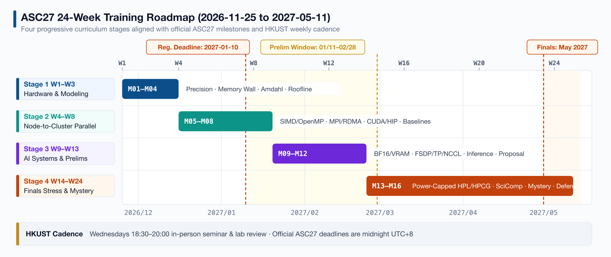

# HKUST ASC Team: ASC27 First-Principles HPC & AI Systems Curriculum

This repository (`hkust-asc/asc27-curriculum`) hosts the training curriculum for the HKUST ASC Team. It takes zero-foundation undergraduates through physical hardware limits, parallel programming, quantitative performance modeling, AI systems, and ASC27 (ASC Student Supercomputer Challenge 2027) preliminary proposal writing and on-site finals execution.

The syllabus spans 24 weeks (2026-11-25 to 2027-05-11) at 8 to 12 hours per person per week, anchored on HKUST ASC Wednesday evening sessions (18:30 to 20:00 HKT).

## Documentation Navigation

- [Knowledge Graph](docs/knowledge-graph.md): 5-layer first-principles dependency tree, explicit bottlenecks and LaTeX math models per node, and mapping of all 7 source attachments.
- [24-Week Roadmap](docs/roadmap.md): verified ASC27 schedule, 4-stage overview table, weekly sprint checklist, and lab verification rubric.
- [16-Module Curriculum Script](docs/curriculum-script.md): structured slide outlines, visual designs, derivations, CLI lab commands, and references for M01 to M16.
- [Past ASC Problems](docs/past-problems.md): verified technical analyses of 10 real past ASC tasks (C01 to C10) grounded in official notifications and committee talks.

## Slide Decks (LibreOffice Source & Exports)

| Deck | Scope | LibreOffice `.odp` | PowerPoint `.pptx` | PDF `.pdf` |
| --- | --- | --- | --- | --- |
| 00 | Overview, Knowledge Graph & 24-Week Roadmap | [slides/odp/00-overview-roadmap.odp](slides/odp/00-overview-roadmap.odp) | [slides/pptx/00-overview-roadmap.pptx](slides/pptx/00-overview-roadmap.pptx) | [slides/pdf/00-overview-roadmap.pdf](slides/pdf/00-overview-roadmap.pdf) |
| 01 | Stage 1 Foundations (M01 to M04) | [slides/odp/01-stage1-foundations.odp](slides/odp/01-stage1-foundations.odp) | [slides/pptx/01-stage1-foundations.pptx](slides/pptx/01-stage1-foundations.pptx) | [slides/pdf/01-stage1-foundations.pdf](slides/pdf/01-stage1-foundations.pdf) |
| 02 | Stage 2 Parallelism & Acceleration (M05 to M08) | [slides/odp/02-stage2-parallelism.odp](slides/odp/02-stage2-parallelism.odp) | [slides/pptx/02-stage2-parallelism.pptx](slides/pptx/02-stage2-parallelism.pptx) | [slides/pdf/02-stage2-parallelism.pdf](slides/pdf/02-stage2-parallelism.pdf) |
| 03 | Stage 3 AI Systems & Performance Tuning (M09 to M12) | [slides/odp/03-stage3-ai-systems.odp](slides/odp/03-stage3-ai-systems.odp) | [slides/pptx/03-stage3-ai-systems.pptx](slides/pptx/03-stage3-ai-systems.pptx) | [slides/pdf/03-stage3-ai-systems.pdf](slides/pdf/03-stage3-ai-systems.pdf) |
| 04 | Stage 4 ASC Competition Sprint (M13 to M16) | [slides/odp/04-stage4-asc-sprint.odp](slides/odp/04-stage4-asc-sprint.odp) | [slides/pptx/04-stage4-asc-sprint.pptx](slides/pptx/04-stage4-asc-sprint.pptx) | [slides/pdf/04-stage4-asc-sprint.pdf](slides/pdf/04-stage4-asc-sprint.pdf) |
| 05 | Past ASC Competition Problems (C01 to C10) | [slides/odp/05-past-asc-problems.odp](slides/odp/05-past-asc-problems.odp) | [slides/pptx/05-past-asc-problems.pptx](slides/pptx/05-past-asc-problems.pptx) | [slides/pdf/05-past-asc-problems.pdf](slides/pdf/05-past-asc-problems.pdf) |

## Knowledge Graph & Roadmap




Mermaid source is stored in [diagrams/knowledge-graph.mmd](diagrams/knowledge-graph.mmd) and explained node by node in [docs/knowledge-graph.md](docs/knowledge-graph.md).

## Build Instructions

All figures and slide exports are script-generated; edit the scripts or Markdown sources rather than patching exported `.pptx` or `.pdf` files by hand.

```bash
python3 scripts/generate_all_diagrams.py
python3 scripts/build_decks.py
```

Convert the generated `.odp` decks to PowerPoint and PDF with headless LibreOffice:

```bash
soffice --headless --convert-to pptx --outdir slides/pptx slides/odp/*.odp
soffice --headless --convert-to pdf --outdir slides/pdf slides/odp/*.odp
```

Standalone SVG-to-PNG rendering follows `DESIGN_SPEC.md`:

```bash
rsvg-convert -d 300 -p 300 -w 1800 input.svg -o output.png
# Use -w 2200 for wide 00_* overview diagrams
```

## Source Attribution & Rule Boundaries

Every claim in this repository separates three tiers of evidence so team proposals never conflate historical baselines with ASC27 regulations.

**Tier 1: Official ASC Notices (Authoritative for Their Respective Years Only)**
- *2027 ASC Student Supercomputer Challenge Call for Participation*: 5 undergraduate students plus 1 faculty advisor; multiple preliminary teams per university allowed, maximum 1 finalist team per university; registration 2026-11-19 to 2027-01-10; preliminary round 2027-01-11 to 2027-02-28; finals in May 2027; all deadlines fall at midnight UTC+8. Finals require on-site cluster building, HPL and HPCG benchmarks, AI and scientific application optimization, and poster plus oral presentation. Official ASC27 power cap, hardware list, exact May dates, and scoring formula are still TBD by the ASC Committee.
- *ASC22 Preliminary Round Notification* and *ASC22 Final Competition Notification*: historical rules for Yuan 4.7B LLM, DeePMD, 3 kW on-site power limit, HPCG 3.0 minimum 1800-second runtime without Quick Path, mathematical equivalence for algorithmic edits, and scoring equations.

**Tier 2: Committee Talks & Team Case Studies (Historical Context, Non-Binding)**
- *ASC26 Competition Optimization & Innovation Introduction* (Liu Yu, ASC Committee, Oct 2026): historical overview of the 25-team Wuxi finals, 5 kW cluster cap (node cap 2 kW, at least 3 nodes), HPL/HPCG winners, and team approaches for UnifoLM-WMA-0, AMSS-NCKU, QiboTN, LeWorldModel, and ICON.
- *Bringing Black Holes onto GPUs: ASC26 AMSS-NCKU Experience* (Song Jiaxing, Tsinghua University ASC26 team): single-step profiling progression on a 4x H100 + 256-core EPYC 9755 preparation machine without NVLink.
- *ASC26 September Roadshow: Hong Kong Station* (Kwan Wing-Keung, ASC Committee Standing Member): historical growth of ASC since 2012, cross-institution collaboration, and application evolution.

**Tier 3: Curriculum Taxonomy**
- *Map of HPC*: structural taxonomy separating hardware, parallel models, performance engineering, and applications; supplies zero competition rules or scores.

Historical power limits (ASC22 3 kW, ASC25 4 kW, ASC26 5 kW) appear strictly as stress-test baselines in Stage 4 until the ASC27 Committee publishes official hardware and power regulations.
