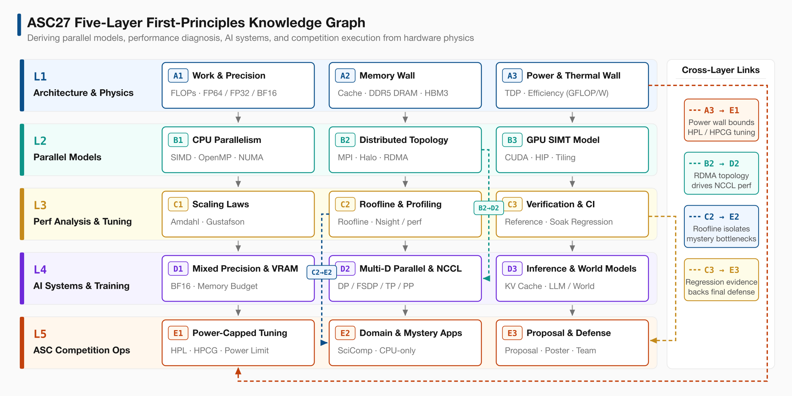

# HKUST ASC Team: ASC27 HPC and AI Systems Curriculum

This repository holds the training curriculum for the HKUST ASC Team. It prepares beginners for ASC27 (ASC Student Supercomputer Challenge 2027), covering hardware limits, parallel code, performance modeling, AI systems, and competition workflows.

The schedule runs 24 weeks from 2026-11-25 to 2027-05-11. Members spend 8 to 12 hours per week, anchored on Wednesday evening sessions (18:30 to 20:00 HKT).

## Interactive Website

Open the interactive site on GitHub Pages to explore concepts with live animations, sliders, and charts:
`https://hkust-asc.github.io/asc27-curriculum/`

You can also open `site/index.html` locally in any browser.

## Documentation

- [Knowledge Graph](docs/knowledge-graph.md): Five-layer dependency tree, bottlenecks, math models, and source mapping.
- [24-Week Roadmap](docs/roadmap.md): Official ASC27 dates, four-stage table, weekly tasks, and lab pass criteria.
- [16-Module Teaching Script](docs/curriculum-script.md): Slide outlines, lab commands, and reading list for M01 to M16.
- [Past ASC Problems](docs/past-problems.md): Technical breakdown of 10 real ASC problems (C01 to C10).

## Slide Decks

| Deck | Scope | LibreOffice `.odp` | PowerPoint `.pptx` | PDF `.pdf` |
| --- | --- | --- | --- | --- |
| 00 | Overview, Knowledge Graph, and Roadmap | [slides/odp/00-overview-roadmap.odp](slides/odp/00-overview-roadmap.odp) | [slides/pptx/00-overview-roadmap.pptx](slides/pptx/00-overview-roadmap.pptx) | [slides/pdf/00-overview-roadmap.pdf](slides/pdf/00-overview-roadmap.pdf) |
| 01 | Stage 1 Foundations (M01 to M04) | [slides/odp/01-stage1-foundations.odp](slides/odp/01-stage1-foundations.odp) | [slides/pptx/01-stage1-foundations.pptx](slides/pptx/01-stage1-foundations.pptx) | [slides/pdf/01-stage1-foundations.pdf](slides/pdf/01-stage1-foundations.pdf) |
| 02 | Stage 2 Parallelism and GPUs (M05 to M08) | [slides/odp/02-stage2-parallelism.odp](slides/odp/02-stage2-parallelism.odp) | [slides/pptx/02-stage2-parallelism.pptx](slides/pptx/02-stage2-parallelism.pptx) | [slides/pdf/02-stage2-parallelism.pdf](slides/pdf/02-stage2-parallelism.pdf) |
| 03 | Stage 3 AI Systems and Porting (M09 to M12) | [slides/odp/03-stage3-ai-systems.odp](slides/odp/03-stage3-ai-systems.odp) | [slides/pptx/03-stage3-ai-systems.pptx](slides/pptx/03-stage3-ai-systems.pptx) | [slides/pdf/03-stage3-ai-systems.pdf](slides/pdf/03-stage3-ai-systems.pdf) |
| 04 | Stage 4 ASC Competition Sprint (M13 to M16) | [slides/odp/04-stage4-asc-sprint.odp](slides/odp/04-stage4-asc-sprint.odp) | [slides/pptx/04-stage4-asc-sprint.pptx](slides/pptx/04-stage4-asc-sprint.pptx) | [slides/pdf/04-stage4-asc-sprint.pdf](slides/pdf/04-stage4-asc-sprint.pdf) |
| 05 | Past ASC Problems (C01 to C10) | [slides/odp/05-past-asc-problems.odp](slides/odp/05-past-asc-problems.odp) | [slides/pptx/05-past-asc-problems.pptx](slides/pptx/05-past-asc-problems.pptx) | [slides/pdf/05-past-asc-problems.pdf](slides/pdf/05-past-asc-problems.pdf) |

## Knowledge Graph and Roadmap




Mermaid source: [diagrams/knowledge-graph.mmd](diagrams/knowledge-graph.mmd).

## Build Commands

Edit the Python scripts or Markdown files to update figures and decks.

```bash
python3 scripts/generate_all_diagrams.py
python3 scripts/build_decks.py
```

Export `.odp` decks to PowerPoint and PDF with headless LibreOffice:

```bash
soffice --headless --convert-to pptx --outdir slides/pptx slides/odp/*.odp
soffice --headless --convert-to pdf --outdir slides/pdf slides/odp/*.odp
```

Render an SVG diagram to PNG:

```bash
rsvg-convert -d 300 -p 300 -w 1800 input.svg -o output.png
# Use -w 2200 for wide 00_* overview diagrams
```

## Sources

- **2027 ASC Call for Participation**: Registration runs 2026-11-19 to 2027-01-10. Preliminary round runs 2027-01-11 to 2027-02-28. Finals happen in May 2027. Teams have 5 undergraduates and 1 faculty advisor (max 1 finalist team per university). All deadlines are midnight UTC+8. ASC27 power cap, hardware list, and scoring weights are TBD.
- **ASC22 Preliminary and Final Notifications**: Historical reference for Yuan 4.7B LLM, DeePMD, 3 kW power cap, and HPCG 1800-second runtime rules.
- **ASC26 Committee Talk** (Liu Yu, Oct 2026): Overview of the Wuxi finals (25 teams, 5 kW cluster cap, 2 kW node cap, at least 3 nodes) and team methods for UnifoLM-WMA-0, AMSS-NCKU, QiboTN, LeWorldModel, and ICON.
- **ASC26 AMSS-NCKU Talk** (Song Jiaxing, Tsinghua): Single-step GPU porting progression on 4x H100 (no NVLink) and dual EPYC 9755 CPUs.
- **ASC26 Hong Kong Roadshow** (Kwan Wing-Keung): ASC history since 2012 and past frontier applications.
- **Map of HPC**: General taxonomy of HPC hardware, parallel models, and tools.
