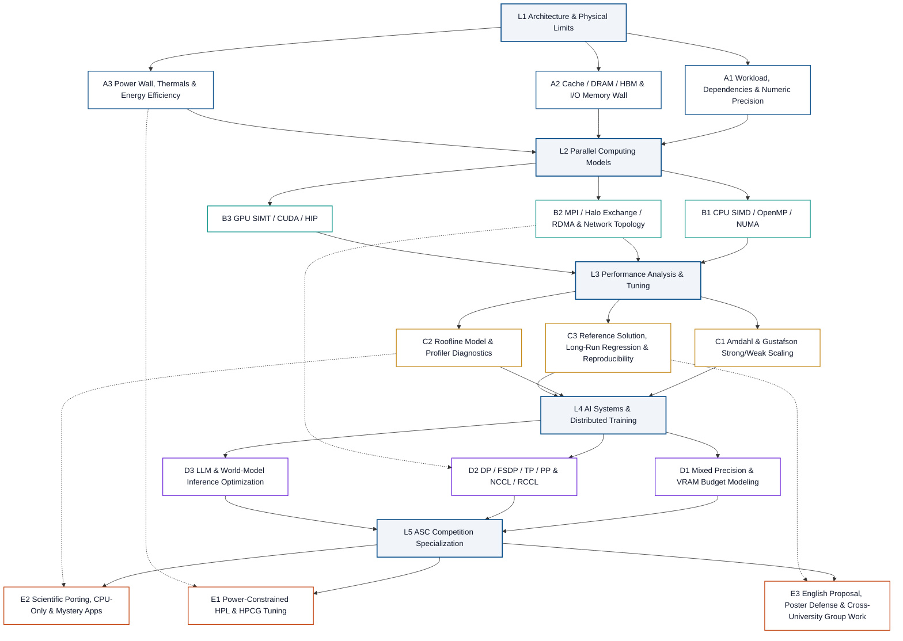

# First-Principles Knowledge Graph

This curriculum has five layers. Each layer solves a physical or computing bottleneck and uses a clear math model.

Solid arrows show prerequisites between layers. Dashed arrows show four direct links between low-level limits and ASC finals work.

Diagram: [diagrams/png/00_knowledge_graph.png](../diagrams/png/00_knowledge_graph.png). Mermaid file: [diagrams/knowledge-graph.mmd](../diagrams/knowledge-graph.mmd).

## Source Mapping

| Document | Type | Mapped Nodes | Facts Used |
| --- | --- | --- | --- |
| *2027 ASC Call for Participation* | Official ASC27 rules | `E1`, `E3` | 5 undergrads + 1 advisor; max 1 finalist team/university; registration 2026-11-19 to 2027-01-10; prelim 2027-01-11 to 2027-02-28; finals May 2027; deadlines midnight UTC+8; power cap, hardware list, and scoring weights TBD |
| *ASC22 Preliminary Notification* | Historical (ASC22) | `A1`, `D1`, `D2`, `E1`, `E3` | 3 kW design budget; HPL + HPCG (15 pts); Yuan 4.7B LLM (40 layers, $d=3072$, 24 heads, seq 2048, 1B tokens, loss $< 7.0$, PyTorch, 30 pts); DeePMD on water, Cu, Al-Cu-Mg (`dp test`, 30 pts) |
| *ASC22 Final Notification* | Historical (ASC22) | `A3`, `E1`, `E2`, `E3` | 3 kW on-site power cap; HPCG 3.0 min 1800 s runtime without Quick Path; mathematical equivalence rule; 90 performance pts + 10 defense pts (under 10 min talk, 3 to 5 min Q&A, up to 2 speakers) |
| *ASC26 Optimization Intro* (Liu Yu, Oct 2026) | Committee talk (ASC26) | `A2`, `A3`, `C2`, `C3`, `D3`, `E1`, `E2`, `E3` | Wuxi finals: 25 teams, 99 servers, 174 GPUs (AMD 52.3%), 5 kW cluster cap (node $\le 2$ kW, $\ge 3$ nodes), 90 opt + 10 defense pts, group 8 pts; HPL/HPCG winners; UnifoLM-WMA-0, AMSS-NCKU, QiboTN, LeWorldModel, ICON |
| *AMSS-NCKU GPU Porting* (Song Jiaxing, Tsinghua) | Team talk (ASC26) | `A2`, `B3`, `C2`, `C3`, `E2` | 4x H100 (no NVLink) + dual EPYC 9755 (256 cores); step time: CPU 4.5 s to GPU v1 4.7 s (122 roundtrips) to resident 1.4 s to 2+62 core split 1.0 s to 3-stage relay 0.85 s; 200-step stale-copy drift (>60x error); 150+ commits |
| *ASC26 HK Roadshow* (Kwan Wing-Keung) | Committee talk | `E3` | ASC started in 2012 (27 universities); expanded across Asia in 2013; near-500 prelim teams; Hong Kong entry in 2025; past apps (SKA, AlphaFold2/3, WRF-Chem, 3D seismic) |
| *Map of HPC* | Taxonomy | `L1` to `L5` | Maps applications to algorithms, parallel models, profilers, and hardware |

Four cross-layer links connect hardware limits to competition tasks:
- `A3 -.-> E1`: Power caps set cluster hardware, DVFS clocks, and HPL/HPCG speed.
- `B2 -.-> D2`: Network latency, bandwidth, and HCA layout control NCCL/RCCL collective speed.
- `C2 -.-> E2`: Roofline plots and timelines find shifting bottlenecks in scientific apps.
- `C3 -.-> E3`: Reference tests and 200-step regressions build the proof needed for proposals and Q&A.

## Layer 1: Architecture and Physical Limits

Hardware physics sets hard upper limits on speed. Every optimization starts with operation count, memory traffic, and power.

### A1 Workload, Dependencies, and Numeric Precision

**Bottleneck:** Parallel speedup needs independent work. Loop-carried dependencies force serial execution. Lower bit width runs faster, but rounding error can break accuracy tests.

**Math model:** An $n \times n$ dense matrix multiply $C = AB$ executes $2n^3$ floating-point operations (multiply and add counted separately). Effective speed is:

$$W_{\mathrm{GEMM}} = 2n^3, \qquad P_{\mathrm{eff}} = \frac{W}{T_{\mathrm{wall}}}.$$

LU factorization in HPL needs $W_{\mathrm{LU}} = \frac{2}{3}n^3 + O(n^2)$ FLOPs. IEEE-754 unit roundoff is $u = 2^{-(m+1)}$, with mantissa bits $m=52$ (FP64), $m=23$ (FP32), $m=10$ (FP16), and $m=7$ (BF16). Autoregressive LLM training (ASC22 Yuan 4.7B) minimizes token negative log-likelihood:

$$\mathrm{Loss} = \sum_{k=1}^{n} -\log P(x_k \mid x_1, \dots, x_{k-1}),$$

with a target of $\mathrm{Loss} < 7.0$ over 1B tokens.

### A2 Cache, DRAM, HBM, and I/O Memory Wall

**Bottleneck:** Compute cores finish many math operations per cycle. Off-chip DRAM, HBM, and PCIe deliver far fewer bytes per cycle. Cache misses and repeated host-device copies stall the processor.

**Math model:** Data transfer time follows the Hockney model:

$$T(m) = \alpha + \frac{m}{B}.$$

Here $\alpha$ is startup latency, $m$ is bytes moved, and $B$ is sustained bandwidth. Arithmetic intensity $I = W / Q$ (FLOPs per byte) compares to machine balance $I_b = P_{\mathrm{peak}} / B$. When $I < I_b$, memory bandwidth limits speed.

State-vector quantum simulation hits an exponential memory wall. Storing $2^n$ complex amplitudes in `complex128` (16 bytes each) requires:

$$M(n) = 16 \cdot 2^{n}\ \text{bytes} \implies M(20) = 16\ \mathrm{MiB}, \qquad M(40) = 16\ \mathrm{TiB}.$$

*Unit note:* Slide p.20 of the ASC26 talk prints `16 GB` and `16 PB` (a 1024x typo). Exact values are **16 MiB** (20 qubits) and **16 TiB** (40 qubits). Tensor-network contraction (QiboTN) avoids this wall for low-entanglement circuits.

### A3 Power Wall, Thermals, and Energy Efficiency

**Bottleneck:** Dynamic power rises faster than clock speed because higher frequency needs higher voltage. In ASC finals, exceeding the rack power meter invalidates the active run.

**Math model:** CMOS switching power and energy efficiency follow:

$$P_{\mathrm{dyn}} \propto C_{\mathrm{eff}} V^{2} f, \qquad E = \int_{0}^{T} P(t)\,dt, \qquad \eta_{\mathrm{energy}} = \frac{W}{E}\ \text{(FLOP/J)}.$$

Lowering $(V, f)$ with DVFS cuts power roughly cubically when $V \propto f$. Historical power caps used as practice targets are 3 kW (ASC22), 4 kW (ASC25), and 5 kW (ASC26). The ASC27 power cap is TBD.

## Layer 2: Parallel Computing Models

Layer 2 maps work onto vector lanes, CPU cores, cluster nodes, and GPU streaming multiprocessors.

### B1 CPU SIMD, OpenMP, and NUMA

**Bottleneck:** Scalar loops leave vector lanes idle. Multithreaded loops slow down when threads write to the same 64-byte cache line (false sharing) or read DRAM on a remote NUMA socket.

**Math model:** Vector width $v$ scales FMA throughput up to $v\times$ (4 FP64 lanes in AVX2, 8 in AVX-512) for unit-stride loops. Cross-socket access increases $\alpha$ and lowers $B$ in $T(m) = \alpha + m/B$. First-touch page allocation and core pinning (`OMP_PROC_BIND`, `numactl`) keep memory traffic local.

### B2 MPI, Halo Exchange, RDMA, and Network Topology

**Bottleneck:** Splitting a grid across ranks creates boundary (halo) exchanges on every step. Small messages stall on latency $\alpha$. Large collectives saturate link bandwidth $B$.

**Math model:** A 3D subdomain of edge $L$ has $O(L^3)$ compute and $O(L^2)$ surface halo traffic. For a $p$-rank ring All-Reduce on a $G$-byte buffer, each rank moves:

$$V_{\mathrm{ring}} = 2 \frac{p - 1}{p} G\ \text{bytes}, \qquad T_{\mathrm{ring}}(G) = 2(p - 1)\alpha + 2\frac{p - 1}{p}\frac{G}{B}.$$

RDMA bypasses the OS kernel to cut $\alpha$. Per-socket InfiniBand HCAs preserve bisection bandwidth $B$.

### B3 GPU SIMT, CUDA, and HIP

**Bottleneck:** GPUs hide HBM latency by running thousands of warps or wavefronts. Warp divergence, uncoalesced loads, high register spills, and PCIe transfers break latency hiding.

**Math model:** Tiling GEMM with $b \times b$ shared-memory blocks cuts HBM reads per tile from $O(b^3)$ to $O(b^2)$ and raises intensity to $O(b)$ FLOPs/byte. On PCIe servers without NVLink, keeping arrays resident on one GPU removes repeated $T_{\mathrm{PCIe}}(m)$ copies. In Tsinghua's AMSS-NCKU run, this cut step time from 4.7 s to 1.4 s.

## Layer 3: Performance Analysis and Tuning

Layer 3 measures scaling limits, finds the true bottleneck, and verifies numerical accuracy.

### C1 Amdahl and Gustafson Scaling

**Bottleneck:** Adding cores gives shrinking returns when serial code, barriers, or load imbalance dominate runtime.

**Math model:** Fixed-size strong scaling with parallel fraction $f$ across $k$ workers follows Amdahl's Law:

$$S_{\mathrm{strong}}(k) = \frac{1}{(1 - f) + \frac{f}{k}} \xrightarrow{k \to \infty} \frac{1}{1 - f}.$$

Growing problem size linearly with $k$ follows Gustafson's Law:

$$S_{\mathrm{scaled}}(k) = (1 - f) + f k.$$

In ASC26 AMSS-NCKU, a 1.47x faster RHS kernel gave only 1.22x full-step speedup because RHS took 20% of step time.

### C2 Roofline Model and Profiler Diagnostics

**Bottleneck:** Tuning math instructions on a memory-bound kernel wastes time. You must identify the active ceiling before editing code.

**Math model:** Attainable speed $R$ follows the Roofline bound:

$$R \le \min\!\left(P_{\mathrm{peak}},\; B \cdot I\right), \qquad I = \frac{W}{Q}.$$

Use `perf` for CPU cache and IPC counters, Score-P for MPI wait times, Nsight Systems (`nsys`) for host-device timeline gaps, and Nsight Compute (`ncu`) for kernel Roofline metrics.

### C3 Reference Solution, Long-Run Regression, and Reproducibility

**Bottleneck:** Short tests miss numerical drift and stale GPU buffers. Unlogged experiments cannot be reproduced during grading.

**Math model:** Accuracy against a reference output $r$ uses relative root-mean-square error:

$$\mathrm{RMS} = \frac{\lVert x - r \rVert_2}{\lVert r \rVert_2}.$$

In ASC26 AMSS-NCKU, trajectory error had to stay under $\mathrm{RMS} < 1\%$ with ADM violation $< 2$. Stale copies passed at 50 steps but failed by over 60x at 200 steps. Always pair fixed seeds, exact CLI flags, and automated 200-step checks.

## Layer 4: AI Systems and Distributed Training

Layer 4 applies hardware limits and profiling to neural network training and inference.

### D1 Mixed Precision and VRAM Budgeting

**Bottleneck:** Gradients, FP32 optimizer states, and activations overflow single-GPU memory on large models. Lower precision saves memory and speeds up Tensor Cores, while risking underflow.

**Math model:** Mixed-precision Adam on $\Phi$ parameters uses about:

$$M_{\mathrm{static}} \approx (2 + 2 + 4 + 4 + 4)\,\Phi = 16\,\Phi\ \text{bytes}.$$

Activation memory scales with $\mathrm{batch} \cdot L \cdot n_{\mathrm{seq}} \cdot d$. Activation checkpointing recomputes layers to cut activation RAM. FP16 needs loss scaling for its 5-bit exponent. BF16 keeps FP32's 8-bit exponent and trains directly. FP8 needs block scaling and compliance checks.

### D2 DP, FSDP, TP, PP, and NCCL/RCCL

**Bottleneck:** Multi-GPU training adds communication cost that depends on how weights, activations, and layers are split.

**Math model:** Data Parallelism (DDP) replicates static state and runs Ring All-Reduce on gradients $G = b_g \Phi$ each step ($2\frac{p-1}{p}G$ bytes per GPU). FSDP/ZeRO-3 shards all static state by $1/p$ using All-Gather and Reduce-Scatter. Tensor Parallelism (TP) splits layer GEMMs and needs fast intra-node NVLink or XGMI. Pipeline Parallelism (PP) splits layers across $p_{\mathrm{pp}}$ stages over $m$ micro-batches with bubble fraction:

$$f_{\mathrm{bubble}} \approx \frac{p_{\mathrm{pp}} - 1}{m + p_{\mathrm{pp}} - 1}.$$

NCCL (NVIDIA) and RCCL (AMD) execute these collectives over the network from `B2`.

### D3 LLM and World-Model Inference

**Bottleneck:** LLM prefill is compute-bound, while token-by-token decode is memory-bandwidth-bound due to KV cache reads. Diffusion world models pay high per-step denoising cost plus video encoding I/O.

**Math model:** KV cache memory grows linearly with sequence length $t$:

$$M_{\mathrm{KV}} = 2 \cdot L \cdot b_{\mathrm{sz}} \cdot n_{\mathrm{kv}} \cdot d_h \cdot t \cdot b_e.$$

During single-token decode, each step reads all weights and $M_{\mathrm{KV}}$, keeping intensity near $I \approx 1$ FLOP/byte. Diffusion time is $T_{\mathrm{diff}} = N_{\mathrm{steps}} \cdot T_{\mathrm{step}} + T_{\mathrm{load}} + T_{\mathrm{encode}}$. Step caching (TeaCache), TensorRT/graph compilation, and async video I/O cut runtime while meeting quality targets (PSNR $\ge 25$ in UnifoLM, $\ge 90\%$ success in LeWorldModel).

## Layer 5: ASC Competition Specialization

Layer 5 combines all technical layers under rack power meters, blind apps, and English presentation rules.

### E1 Power-Capped HPL and HPCG

**Bottleneck:** HPL pushes FP64 compute near $P_{\mathrm{peak}}$. HPCG tests memory bandwidth and MPI latency. Both run on one cluster under one power cap.

**Math model:** HPL sustained performance is:

$$R_{\max} = \frac{\frac{2}{3}N^3 + 2N^2}{T_{\mathrm{wall}}}, \qquad \eta_{\mathrm{HPL}} = \frac{R_{\max}}{P_{\mathrm{peak}}}.$$

HPCG runs SpMV, SymGS, and multigrid at $I = O(1)$ FLOP/byte on the bandwidth slope. In ASC26 (5 kW cap), Qilu Univ. of Tech. won HPL (6x H200 + 2x W7900D) and Tsinghua won HPCG (H100 + per-socket InfiniBand).

### E2 Scientific Porting, CPU-Only, and Mystery Apps

**Bottleneck:** Porting CPU codes to GPUs shifts bottlenecks from compute to PCIe transfers to CPU post-processing. CPU-only finals tasks (QiboTN, ICON, ASC25 AlphaFold3/DeepSeek) forbid GPUs. Mystery apps reveal new codebases and target GPUs (like AMD W7900D in ASC26) on site.

**Math model:** Measure phase wall fractions $a_i$ (`C1`, `C2`), remove non-compute stalls (`T(m)` copies, launch gaps, barrier waits), verify accuracy (`C3`), and keep a one-command rollback script.

### E3 English Proposal, Poster Defense, and Group Competition

**Bottleneck:** Speedups earn zero credit if proposals fail similarity checks, omit logs, or fail technical Q&A. Group tasks require sharing code patches across five universities while each team runs on its own cluster.

**Math model:** Grading audits the `C3` evidence chain: git diffs, build and run commands, power logs, ablation tables, and accuracy checks.

## Mermaid Diagram

