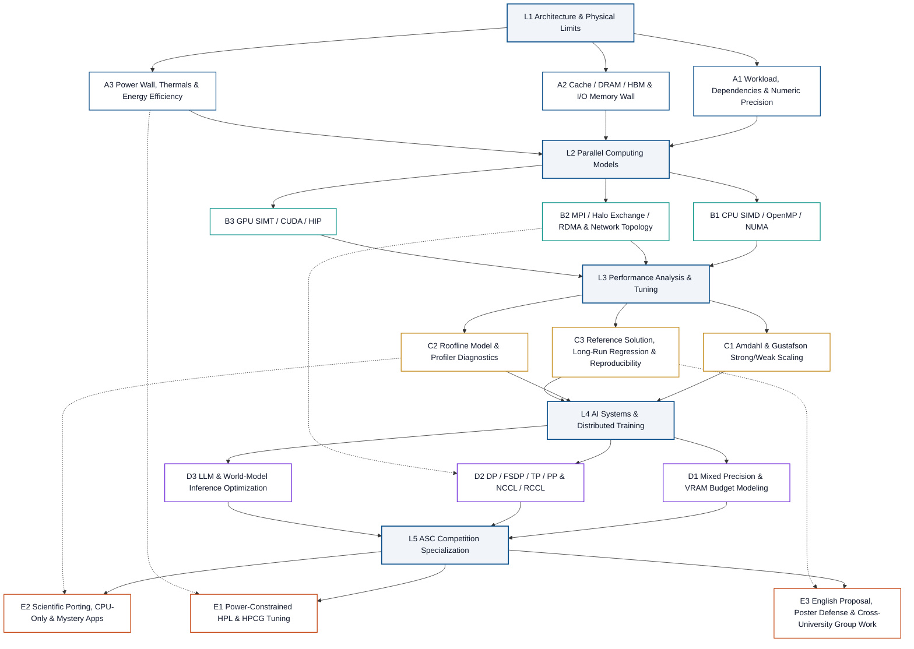

# First-Principles Knowledge Graph

This dependency tree organizes the HKUST ASC27 curriculum into five bottom-up layers. Every node specifies the physical or computational bottleneck it removes and the mathematical model used to verify gains. Solid arrows denote sequential prerequisites across layers. Dashed arrows mark four direct cross-layer paths where lower-level constraints decide finals points.

Rendered figure: [diagrams/png/00_knowledge_graph.png](../diagrams/png/00_knowledge_graph.png). Mermaid source: [diagrams/knowledge-graph.mmd](../diagrams/knowledge-graph.mmd).

## Source Attachment Mapping

The seven reference attachments divide into three tiers: official notices (authoritative only for their own year), committee talks and team case studies (historical engineering evidence), and a general HPC taxonomy.

| Attachment (English Title) | Source Tier | Mapped Nodes | Verified Facts Supplied | Out of Scope (Do Not Extrapolate) |
| --- | --- | --- | --- | --- |
| *2027 ASC Student Supercomputer Challenge Call for Participation* (`2027 ASC Student Supercomputer Challenge Call for Participation.pdf`) | Official rule (ASC27) | `E3`, `E1` (scope of HPL/HPCG only) | 5 undergraduates + 1 faculty advisor; multiple prelim teams per university, max 1 finalist per university; registration 2026-11-19 to 2027-01-10; prelim 2027-01-11 to 2027-02-28; finals May 2027; deadlines midnight UTC+8; student eligibility under 4 academic years; finals cover cluster building, HPL, HPCG, AI and scientific apps, poster and presentation | Power cap, server/GPU BOM, exact May dates, scoring formula, and group competition point weight (all TBD by committee) |
| *ASC22 Preliminary Round Notification* (`ASC22 Preliminary Round Notification.pdf`) | Official historical benchmark (ASC22 prelim) | `A1`, `D1`, `D2`, `E1`, `E3` | 3 kW cluster design constraint; HPL + HPCG (15 pts); Yuan 4.7B LLM (40 layers, $d=3072$, 24 heads, seq 2048, 1B tokens, loss $< 7.0$, PyTorch only, 30 pts); DeePMD on water, Cu, and Al-Cu-Mg with `dp test` verification (30 pts); English proposal structure | Cannot be cited as ASC27 tasks, point allocations, or power caps |
| *ASC22 Final Competition Notification* (`ASC22 Final Competition Notification.pdf`) | Official historical benchmark (ASC22 finals) | `A3`, `E1`, `E2`, `E3` | On-site 3 kW runtime limit (exceeding invalidates current task); HPCG 3.0 minimum 1800-second runtime with Quick Path disabled; mathematical equivalence required for algorithm changes; input-specific tuning banned; 90 performance pts + 10 oral presentation pts (under 10 min, 3 to 5 min Q&A, up to 2 student speakers); group competition formula | 3 kW limit and 9/9/18-point split apply strictly to ASC22 |
| *ASC26 Optimization & Innovation Introduction* (Liu Yu, ASC Committee, Oct 2026; v6-1 PDF) | Committee retrospective talk (ASC26) | `A2`, `A3`, `C2`, `C3`, `D3`, `E1`, `E2`, `E3` | Wuxi finals with 25 teams, 99 servers, 174 GPUs (AMD 52.3%), 5 kW cluster cap (node $\le 2$ kW, $\ge 3$ nodes), 90 optimization + 10 defense pts, group competition 8 pts; HPL/HPCG winners (Qilu Univ. of Tech. and Tsinghua); team highlights for UnifoLM-WMA-0, AMSS-NCKU, QiboTN, LeWorldModel, ICON; proposal similarity check | 5 kW cap, hardware list, and scoring weights reflect ASC26 finals only; slide p.20 misprints state-vector memory as 16 GB / 16 PB instead of 16 MiB / 16 TiB (corrected under `A2`) |
| *Bringing Black Holes onto GPUs: ASC26 AMSS-NCKU Experience* (Song Jiaxing, Tsinghua ASC26 talk PDF) | Team case study (ASC26) | `A2`, `B3`, `C2`, `C3`, `E2` | Preparation machine: 4x H100 (no NVLink) + dual AMD EPYC 9755 (256 cores); step time progression CPU ~4.5 s to GPU v1 4.7 s (122 host-device roundtrips) to resident GPU 1.4 s to 2+62 core split 1.0 s to 3-stage relay 0.85 s; 200-step stale-copy drift (>60x error while 50 steps looked clean); 150+ verified incremental commits | Single-step timing on preparation hardware is a methodology case study, distinct from official finals runtime |
| *ASC26 September Roadshow: Hong Kong Station* (Kwan Wing-Keung, ASC Committee Standing Member, roadshow PDF) | Committee context talk | `E3` | ASC origin in 2012 (27 mainland universities), expansion to Asia in 2013 (43 universities) and near-500 prelim registrations, Hong Kong registration in 2025, frontier applications (SKA, AlphaFold2/3, WRF-Chem, 3D seismic) | Contains no hardware specs, power limits, or math models |
| *Map of HPC* (`Map of HPC.jpeg`) | Reference taxonomy (non-ASC) | `L1` through `L5` structure (`A1`, `B1`–`B3`, `C2`) | Maps application domains to algorithms, parallel programming models, profiling tools, and hardware architectures | Supplies zero ASC rules, dates, hardware limits, or scoring criteria |

Four cross-layer links tie physical limits and diagnostic discipline directly to ASC finals execution:
- `A3 -.-> E1`: power and thermal ceilings constrain cluster architecture, DVFS frequency, and HPL/HPCG efficiency.
- `B2 -.-> D2`: interconnect latency, bandwidth, and HCA topology govern NCCL/RCCL collective cost in distributed AI training.
- `C2 -.-> E2`: Roofline placement and timeline profiling locate shifting bottlenecks during scientific GPU porting and mystery apps.
- `C3 -.-> E3`: reference solutions and long-run regression scripts build the reproducible evidence chain graded in proposals and oral defenses.

## First-Principles Dependency Tree

Each node defines (a) the physical or computational bottleneck it solves and (b) its governing mathematical model.

### L1 Architecture & Physical Limits

Every upper-layer runtime behavior traces back to operation counts, data movement across memory hierarchies, and silicon power dissipation.

#### A1 Workload, Dependencies & Numeric Precision

- **Bottleneck.** Parallel speedup requires independent operations. Dense linear algebra grows cubically in arithmetic work, yet loop-carried dependencies serialize pipelines regardless of core count. Reducing bit width increases throughput while accumulating rounding drift that breaks competition accuracy gates.
- **Governing Math Model.** For $n \times n$ dense matrix multiplication $C = AB$ counting multiply and add separately, total floating-point work is

$$W_{\mathrm{GEMM}} = 2n^3, \qquad P_{\mathrm{eff}} = \frac{W}{T_{\mathrm{wall}}}.$$

LU factorization in HPL requires $W_{\mathrm{LU}} = \frac{2}{3}n^3 + O(n^2)$ FLOPs. IEEE-754 binary formats set unit roundoff $u = 2^{-(m+1)}$ with significand bits $m=52$ (FP64), $m=23$ (FP32), $m=10$ (FP16), and $m=7$ (BF16). In autoregressive language modeling (ASC22 Yuan 4.7B), the convergence objective is token negative log-likelihood

$$\mathrm{Loss} = \sum_{k=1}^{n} -\log P(x_k \mid x_1, \dots, x_{k-1}),$$

gated at $\mathrm{Loss} < 7.0$ over 1B tokens.

#### A2 Cache / DRAM / HBM & I/O Memory Wall

- **Bottleneck.** Modern arithmetic units retire multiple fused multiply-adds per cycle, while off-chip DRAM, HBM, PCIe, and storage deliver far fewer bytes per cycle. Whenever data misses on-chip caches or crosses host-device links repeatedly, bandwidth and latency cap execution speed well below peak FLOP/s.
- **Governing Math Model.** Data transfer cost follows the Hockney latency-bandwidth model

$$T(m) = \alpha + \frac{m}{B},$$

where $\alpha$ is startup latency, $m$ is payload size in bytes, and $B$ is sustained channel bandwidth. Arithmetic intensity $I = W / Q$ (FLOPs per byte moved) compares against machine balance $I_b = P_{\mathrm{peak}} / B$; workloads with $I < I_b$ are memory-bound.

State-vector quantum simulation illustrates an exponential memory wall. Storing $2^n$ complex amplitudes in `complex128` (16 bytes per amplitude) requires

$$M(n) = 16 \cdot 2^{n}\ \text{bytes}.$$

Evaluating $n=20$ and $n=40$ gives

$$M(20) = 16 \cdot 2^{20} = 16\ \mathrm{MiB}, \qquad M(40) = 16 \cdot 2^{40} = 16\ \mathrm{TiB}.$$

**Explicit unit correction:** Slide p.20 of the ASC26 optimization introduction talk labels 20 qubits as `16 GB` and 40 qubits as `16 PB`, an error of $2^{10}$ (1024x) from confusing MiB/TiB with GB/PB. All curriculum materials use the exact values **16 MiB** ($n=20$) and **16 TiB** ($n=40$). Tensor-network contraction (QiboTN) bypasses this exponential wall for low-entanglement circuits.

#### A3 Power Wall, Thermals & Energy Efficiency

- **Bottleneck.** Switching power scales super-linearly with clock frequency because higher frequency demands higher supply voltage. On-site ASC clusters run behind a hard rack power meter where tripping the cap invalidates the run, forcing system-level co-design across node count, accelerators, and clock targets.
- **Governing Math Model.** Dynamic CMOS switching power is

$$P_{\mathrm{dyn}} \propto C_{\mathrm{eff}} V^{2} f, \qquad E = \int_{0}^{T} P(t)\,dt, \qquad \eta_{\mathrm{energy}} = \frac{W}{E}\ \text{(FLOP/J)},$$

where $C_{\mathrm{eff}}$ is effective switched capacitance, $V$ is supply voltage, and $f$ is clock frequency. Under a fixed power cap $P_{\max}$, lowering $(V, f)$ via DVFS reduces $P_{\mathrm{dyn}}$ cubically when $V \propto f$, often preserving higher net performance per watt than dropping active compute units. Historical finals power limits serve strictly as stress-test baselines: ASC22 3 kW, ASC25 4 kW, and ASC26 5 kW (with ASC27 power cap TBD).

### L2 Parallel Computing Models

Layer 2 turns physical concurrency into executable code across vector lanes, CPU cores, distributed nodes, and GPU streaming multiprocessors.

#### B1 CPU SIMD / OpenMP / NUMA

- **Bottleneck.** Scalar loops waste wide vector ALUs (AVX2/AVX-512/SVE). Multithreaded OpenMP loops degrade when threads contend on shared cache lines (false sharing) or allocate pages on remote NUMA sockets with higher latency and lower bandwidth.
- **Governing Math Model.** Vector width $v$ scales independent FMA throughput up to $v\times$ (4 FP64 lanes in AVX2, 8 in AVX-512) provided unit-stride loads and zero loop-carried dependencies. On multi-socket servers, cross-socket access degrades both $\alpha$ and $B$ in $T(m) = \alpha + m/B$. First-touch page placement combined with core pinning (`OMP_PROC_BIND`, `numactl`) minimizes remote DRAM traffic.

#### B2 MPI / Halo Exchange / RDMA & Network Topology

- **Bottleneck.** Domain decomposition splits grids across ranks, creating boundary (halo) dependencies every timestep. Small messages stall on network latency $\alpha$; large collective payloads saturate link bisection bandwidth $B$, especially when multiple sockets share a single HCA.
- **Governing Math Model.** For a 3D subdomain of edge $L$, computation scales as $O(L^3)$ while surface halo traffic scales as $O(L^2)$, yielding a computation-to-communication ratio proportional to $L$. For a $p$-rank ring All-Reduce over a $G$-byte buffer (reduce-scatter followed by all-gather), each rank transfers

$$V_{\mathrm{ring}} = 2 \frac{p - 1}{p} G\ \text{bytes}, \qquad T_{\mathrm{ring}}(G) = 2(p - 1)\alpha + 2\frac{p - 1}{p}\frac{G}{B}.$$

RDMA bypasses host OS copies to cut $\alpha$, while per-socket InfiniBand HCAs preserve bisection $B$ (a decisive design choice in Tsinghua's ASC26 HPCG run).

#### B3 GPU SIMT / CUDA / HIP

- **Bottleneck.** GPUs hide HBM latency by scheduling thousands of warps or wavefronts. Warp divergence, uncoalesced global memory transactions, register spilling that caps occupancy, and host-device PCIe transfers strip away that latency hiding.
- **Governing Math Model.** Tiling an $M \times N \times K$ GEMM with $b \times b$ shared-memory blocks reduces global HBM reads per tile from $O(b^3)$ to $O(b^2)$, raising arithmetic intensity from $O(1)$ to $O(b)$ FLOPs/byte. On PCIe clusters without NVLink, keeping state resident on a single GPU eliminates repeated $T_{\mathrm{PCIe}}(m) = \alpha_{\mathrm{PCIe}} + m / B_{\mathrm{PCIe}}$ roundtrips (turning Tsinghua's AMSS-NCKU step time from 4.7 s down to 1.4 s).

### L3 Performance Analysis & Tuning

Layer 3 stops blind optimization by quantifying scaling ceilings, isolating the active bottleneck, and enforcing numerical verification.

#### C1 Amdahl & Gustafson Strong/Weak Scaling

- **Bottleneck.** Adding cores or nodes stops helping once unparallelized serial work, synchronization, or load imbalance dominates wall-clock time.
- **Governing Math Model.** Fixing total problem size (strong scaling) with parallel fraction $f$ across $k$ workers obeys Amdahl's Law:

$$S_{\mathrm{strong}}(k) = \frac{1}{(1 - f) + \frac{f}{k}} \xrightarrow{k \to \infty} \frac{1}{1 - f}.$$

Scaling parallel work linearly with $k$ while serial overhead stays constant (weak scaling) obeys Gustafson's Law:

$$S_{\mathrm{scaled}}(k) = (1 - f) + f k.$$

A real ASC26 example from Song Jiaxing's AMSS-NCKU profiling: speeding up the RHS kernel by 1.47x yielded only 1.22x full-step speedup because RHS accounted for roughly 20% of wall time.

#### C2 Roofline Model & Profiler Diagnostics

- **Bottleneck.** Tuning compute instructions on a memory-bound kernel, or shrinking memory traffic on a launch-bound loop, wastes competition hours.
- **Governing Math Model.** Attainable compute throughput $R$ satisfies the Roofline bound:

$$R \le \min\!\left(P_{\mathrm{peak}},\; B \cdot I\right), \qquad I = \frac{W}{Q}.$$

Profiling tools separate where time goes before touching code: `perf` for CPU cache/branch/IPC counters, Score-P for MPI wait imbalances, Nsight Systems (`nsys`) for host-device timeline gaps and backpressure, and Nsight Compute (`ncu`) for per-kernel Roofline position, occupancy, and register pressure.

#### C3 Reference Solution, Long-Run Regression & Reproducibility

- **Bottleneck.** Short tests mask subtle numerical divergence and stale host-device state; unversioned tweaks produce non-reproducible numbers rejected during grading or finals.
- **Governing Math Model.** Trajectory or field accuracy against a verified reference $r$ uses relative root-mean-square error:

$$\mathrm{RMS} = \frac{\lVert x - r \rVert_2}{\lVert r \rVert_2}.$$

In ASC26 AMSS-NCKU, black hole trajectory error had to stay below $\mathrm{RMS} < 1\%$ with ADM constraint violation $< 2$; stale host-device copies looked clean at 50 steps yet diverged by more than 60x at 200 steps. Reproducibility pairs deterministic seeds, exact CLI flags, pinned environments, and automated multi-hundred-step regression gates.

### L4 AI Systems & Distributed Training

Layer 4 applies L1–L3 directly to deep learning workloads where tensors, optimizer states, and collective exchanges dominate memory and network budgets.

#### D1 Mixed Precision & VRAM Budget Modeling

- **Bottleneck.** Training billion-parameter models overflows single-GPU HBM once gradients, FP32 optimizer moments, and activations are added to parameter weights. Lowering precision cuts memory footprint and boosts tensor-core throughput while risking gradient underflow or accuracy loss.
- **Governing Math Model.** For a model with $\Phi$ parameters trained with mixed-precision Adam (BF16/FP16 weights and gradients plus FP32 master weights, momentum, and variance), static state consumes approximately

$$M_{\mathrm{static}} \approx (2 + 2 + 4 + 4 + 4)\,\Phi = 16\,\Phi\ \text{bytes},$$

plus activation memory $M_{\mathrm{act}} \propto \mathrm{batch} \cdot L \cdot n_{\mathrm{seq}} \cdot d$ (reducible via activation checkpointing). FP16 requires dynamic loss scaling due to its 5-bit exponent; BF16 retains FP32's 8-bit exponent with 7 mantissa bits; FP8 (E4M3/E5M2) demands per-tensor or block scaling and verification against competition precision gates (e.g., ASC26 UnifoLM prelim $\ge 16$-bit weight constraint).

#### D2 DP / FSDP / TP / PP & NCCL / RCCL

- **Bottleneck.** Scaling beyond one GPU introduces communication overhead that depends on how weights, activations, and layers are partitioned across intra-node and inter-node fabrics.
- **Governing Math Model.** Pure Data Parallelism (DP) replicates $M_{\mathrm{static}}$ and runs a ring All-Reduce of gradient payload $G = b_g \Phi$ each step with volume $2\frac{p-1}{p}G$ per GPU. FSDP/ZeRO-3 shards parameters, gradients, and optimizer states by $1/p$, trading All-Gather and Reduce-Scatter collectives for memory capacity. Tensor Parallelism (TP) splits GEMMs inside each layer and injects All-Reduce calls on every block, demanding high intra-node bandwidth (NVLink/XGMI). Pipeline Parallelism (PP) splits layers into $p_{\mathrm{pp}}$ stages over $m$ micro-batches with pipeline bubble fraction

$$f_{\mathrm{bubble}} \approx \frac{p_{\mathrm{pp}} - 1}{m + p_{\mathrm{pp}} - 1}.$$

NCCL (NVIDIA) and RCCL (AMD) execute these collectives over the physical topology established in `B2`.

#### D3 LLM & World-Model Inference Optimization

- **Bottleneck.** Autoregressive LLM inference splits into two opposite regimes: compute-bound prefill and memory-bandwidth-bound decode driven by KV cache reads. Diffusion world models face high per-step UNet/DiT cost multiplied across iterative denoising steps and video encoding I/O.
- **Governing Math Model.** For an $L$-layer Transformer with $n_{\mathrm{kv}}$ KV heads, head dimension $d_h$, sequence length $t$, batch size $b_{\mathrm{sz}}$, and $b_e$ bytes per element, KV cache memory scales linearly as

$$M_{\mathrm{KV}} = 2 \cdot L \cdot b_{\mathrm{sz}} \cdot n_{\mathrm{kv}} \cdot d_h \cdot t \cdot b_e.$$

During single-token decode, each step reads both model weights and $M_{\mathrm{KV}}$ to compute $O(1)$ token projections, pinning arithmetic intensity near $I \approx 1$ FLOP/byte. World-model diffusion time scales as $T_{\mathrm{diff}} = N_{\mathrm{steps}} \cdot T_{\mathrm{step}} + T_{\mathrm{load}} + T_{\mathrm{encode}}$; step-caching (such as TeaCache $\ell_1$ latent distance gating), compiled TensorRT/graph execution, and asynchronous video I/O cut wall time while preserving perceptual or task metrics (PSNR $\ge 25$ in ASC26 UnifoLM, push success $\ge 90\%$ in LeWorldModel).

### L5 ASC Competition Specialization

Layer 5 integrates L1–L4 into competition constraints: rack power meters, hardware selection, blind application sprints, and formal English engineering communication.

#### E1 Power-Constrained HPL & HPCG Tuning

- **Bottleneck.** HPL pushes sustained FP64 compute near $P_{\mathrm{peak}}$ while HPCG exposes memory bandwidth and MPI halo latency. Both benchmarks run on the same cluster behind the same power cap without mid-contest hardware changes, creating direct hardware and DVFS trade-offs.
- **Governing Math Model.** HPL reports sustained performance

$$R_{\max} = \frac{\frac{2}{3}N^3 + 2N^2}{T_{\mathrm{wall}}}, \qquad \eta_{\mathrm{HPL}} = \frac{R_{\max}}{P_{\mathrm{peak}}},$$

governed by matrix order $N$, block size $NB$, process grid $P \times Q$, and power capping. HPCG evaluates preconditioned conjugate gradient (SpMV, SymGS, multigrid) with $I = O(1)$ FLOP/byte, landing firmly on the memory-bandwidth slope of the Roofline. Historical finals references: ASC22 3 kW limit with HPCG 3.0 $\ge 1800$ s runtime and no Quick Path; ASC26 5 kW limit with HPL winner Qilu Univ. of Tech. (6x H200 + 2x W7900D heterogeneous cluster) and HPCG winner Tsinghua (H100 + per-socket IB). ASC27 power cap, hardware, and scoring formula are TBD.

#### E2 Scientific Porting, CPU-Only & Mystery Apps

- **Bottleneck.** Porting a legacy scientific code to GPUs shifts bottlenecks sequentially from compute to host-device transfers to CPU post-processing backpressure. Conversely, CPU-only finals tasks (QiboTN, ICON, ASC25 AlphaFold3/DeepSeek) disqualify any GPU execution, and mystery applications reveal unfamiliar codebases and target hardware (such as AMD W7900D/ROCm in ASC26 LeWM) only on site.
- **Governing Math Model.** Optimization follows iterative bottleneck accounting from `C1` and `C2`: measure per-phase wall fractions $a_i$, eliminate non-compute stalls (`T(m)` copies, kernel launch overhead, synchronization backpressure), verify mathematical equivalence and accuracy gates (`C3`), and lock safe rollback scripts before finals testing.

#### E3 English Proposal, Poster Defense & Cross-University Group Work

- **Bottleneck.** Technical speedups earn zero credit if preliminary proposals fail similarity screening, omit reproducible logs, violate mathematical equivalence, or fail to withstand technical Q&A during the timed English finals defense. Group competitions require rapid cross-university patch sharing while running independently on each team's own cluster.
- **Governing Math Model.** No new physical equation applies; evaluation audits the closure of the `C3` evidence chain: exact code diffs, build/run commands, hardware topology, power logs, ablation tables, and accuracy verification. ASC27 Call for Participation confirms English proposal selection on academic merit and technical excellence, plus finals poster and presentation; exact page limits, defense duration, and group scoring weights await subsequent ASC27 committee notices.

## Mermaid Visualization

GitHub renders the block below natively. It matches [diagrams/knowledge-graph.mmd](../diagrams/knowledge-graph.mmd) and corresponds to the static figure [diagrams/png/00_knowledge_graph.png](../diagrams/png/00_knowledge_graph.png).

